# 神经形态硬件

[返回图墙索引](../index.md) · [打开网页图库](../../index.html)

共 12 张论文图例。

## Fig. 1 · Weight-delay representations for spiking models

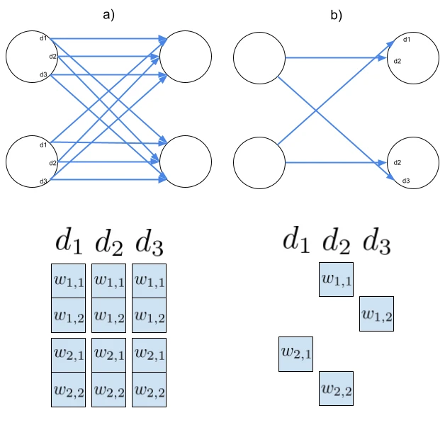

Patiño-Saucedo et al. · *arXiv v1* · 2024  
[Hardware-aware training of models with synaptic delays for digital event-driven neuromorphic processors](https://arxiv.org/html/2404.10597v1#S3.F1) · [原始图片](https://arxiv.org/html/2404.10597v1/figures/weight-delay-repr2.png) · [CC BY 4.0](https://creativecommons.org/licenses/by/4.0/) · [许可出处](https://arxiv.org/abs/2404.10597v1)

## Fig. 2 · Delay model training pipeline

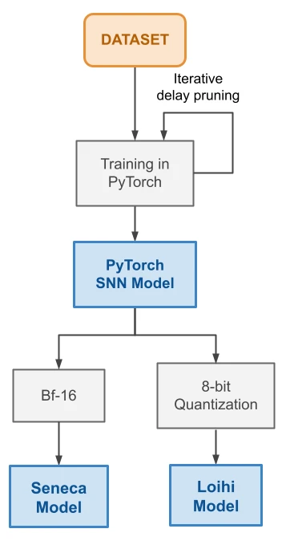

Patiño-Saucedo et al. · *arXiv v1* · 2024  
[Hardware-aware training of models with synaptic delays for digital event-driven neuromorphic processors](https://arxiv.org/html/2404.10597v1#S3.F2) · [原始图片](https://arxiv.org/html/2404.10597v1/figures/Methodology.png) · [CC BY 4.0](https://creativecommons.org/licenses/by/4.0/) · [许可出处](https://arxiv.org/abs/2404.10597v1)

## Fig. 7 · Spiking traces on PyTorch, Seneca and Loihi

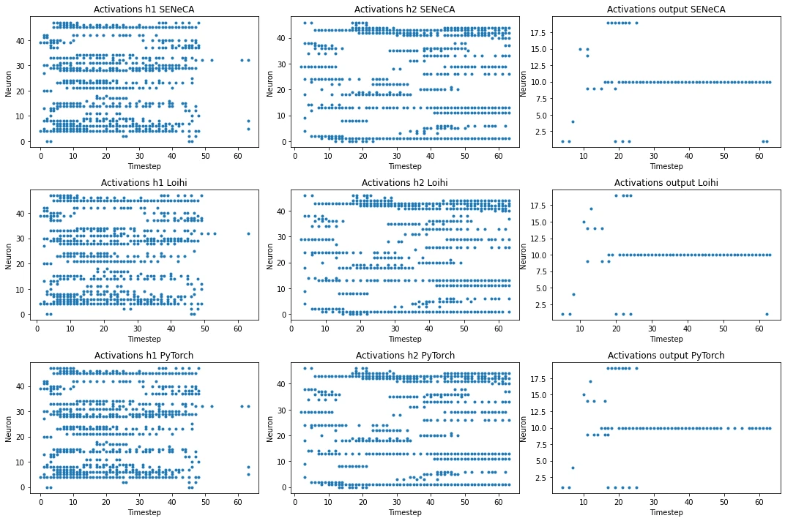

Patiño-Saucedo et al. · *arXiv v1* · 2024  
[Hardware-aware training of models with synaptic delays for digital event-driven neuromorphic processors](https://arxiv.org/html/2404.10597v1#S4.F7) · [原始图片](https://arxiv.org/html/2404.10597v1/figures/spikes_48_48_20.png) · [CC BY 4.0](https://creativecommons.org/licenses/by/4.0/) · [许可出处](https://arxiv.org/abs/2404.10597v1)

## Fig. 2 · SpiNNaker2 chip layout

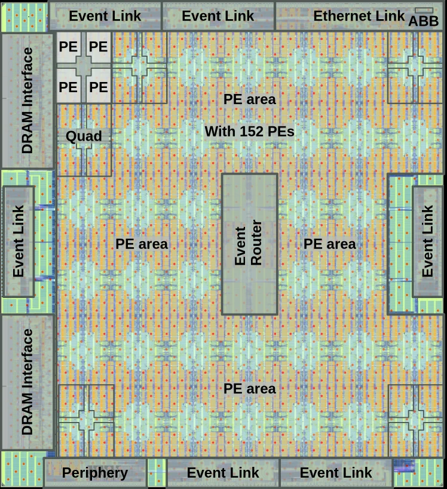

Scholze et al. · *arXiv v1* · 2026  
[The SpiNNaker2 chip: a many-core platform for flexible and scalable brain-inspired computing](https://arxiv.org/html/2607.24396v1#S3.F2) · [原始图片](https://arxiv.org/html/2607.24396v1/figures/s2_layout.png) · [CC BY 4.0](https://creativecommons.org/licenses/by/4.0/) · [许可出处](https://arxiv.org/abs/2607.24396v1)

## Fig. 3 · SpiNNaker2 processing element components

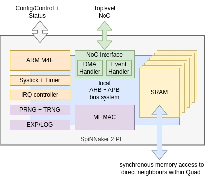

Scholze et al. · *arXiv v1* · 2026  
[The SpiNNaker2 chip: a many-core platform for flexible and scalable brain-inspired computing](https://arxiv.org/html/2607.24396v1#S3.F3) · [原始图片](https://arxiv.org/html/2607.24396v1/figures/s2_pe_2.png) · [CC BY 4.0](https://creativecommons.org/licenses/by/4.0/) · [许可出处](https://arxiv.org/abs/2607.24396v1)

## Fig. 5 · SpiNNaker2 event router

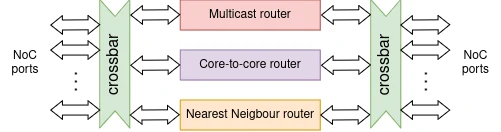

Scholze et al. · *arXiv v1* · 2026  
[The SpiNNaker2 chip: a many-core platform for flexible and scalable brain-inspired computing](https://arxiv.org/html/2607.24396v1#S3.F5) · [原始图片](https://arxiv.org/html/2607.24396v1/figures/s2_event_router.png) · [CC BY 4.0](https://creativecommons.org/licenses/by/4.0/) · [许可出处](https://arxiv.org/abs/2607.24396v1)

## Fig. 6 · Types of benchmarking systems

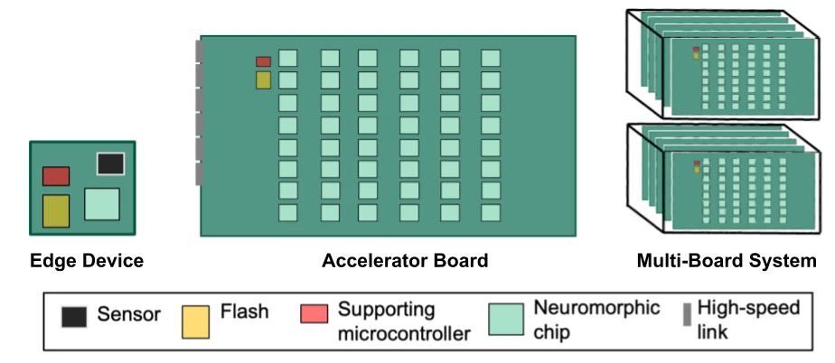

Yik et al. · *arXiv v5* · 2025  
[NeuroBench: A Framework for Benchmarking Neuromorphic Computing Algorithms and Systems](https://arxiv.org/html/2304.04640v5#Sx3.F6) · [原始图片](https://arxiv.org/html/2304.04640v5/figures/system_types.png) · [CC BY 4.0](https://creativecommons.org/licenses/by/4.0/) · [许可出处](https://arxiv.org/abs/2304.04640v5)

## Fig. 10 · Loihi 2 benchmarking setup

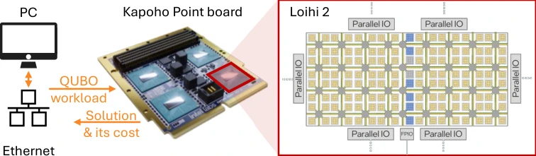

Yik et al. · *arXiv v5* · 2025  
[NeuroBench: A Framework for Benchmarking Neuromorphic Computing Algorithms and Systems](https://arxiv.org/html/2304.04640v5#Sx5.F10) · [原始图片](https://arxiv.org/html/2304.04640v5/Loihi2_Benchmarking.png) · [CC BY 4.0](https://creativecommons.org/licenses/by/4.0/) · [许可出处](https://arxiv.org/abs/2304.04640v5)

## Fig. 2 · Intel Loihi 2 systems from edge devices to HPC

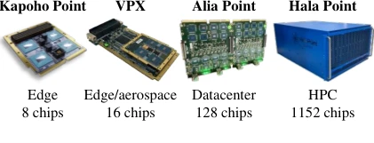

Abreu et al. · *arXiv v2* · 2025  
[Neuromorphic Principles for Efficient Large Language Models on Intel Loihi 2](https://arxiv.org/html/2503.18002v2#A1.F2) · [原始图片](https://arxiv.org/html/2503.18002v2/loihi_systems.png) · [CC BY 4.0](https://creativecommons.org/licenses/by/4.0/) · [许可出处](https://arxiv.org/abs/2503.18002v2)

## Fig. 1 · Overview of the BrainScaleS-2 System architecture

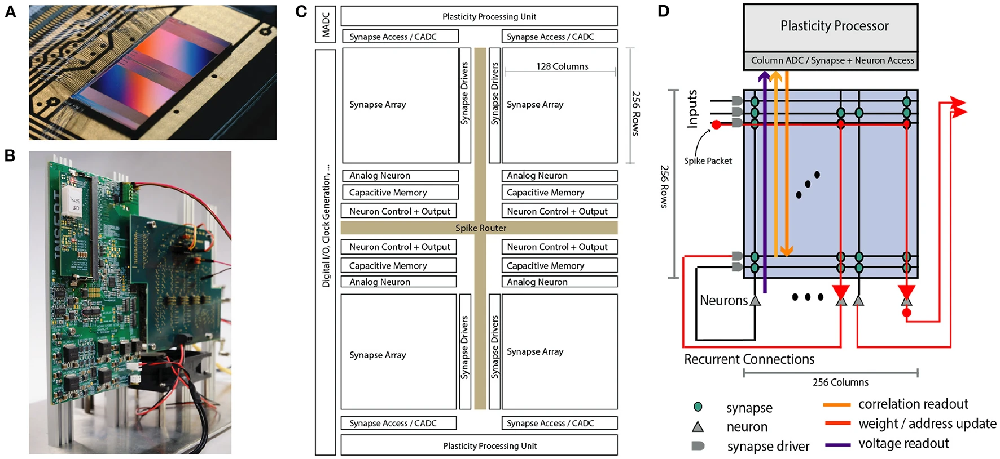

Pehle et al. · *Frontiers in Neuroscience published* · 2022  
[The BrainScaleS-2 Accelerated Neuromorphic System With Hybrid Plasticity](https://pmc.ncbi.nlm.nih.gov/articles/PMC8907969/#F1) · [原始图片](https://www.frontiersin.org/files/Articles/795876/xml-images/fnins-16-795876-g0001.webp) · [CC BY 4.0](https://creativecommons.org/licenses/by/4.0/) · [许可出处](https://www.frontiersin.org/journals/neuroscience/articles/10.3389/fnins.2022.795876/full)

## Fig. 2 · Neuron properties before and after hardware calibration

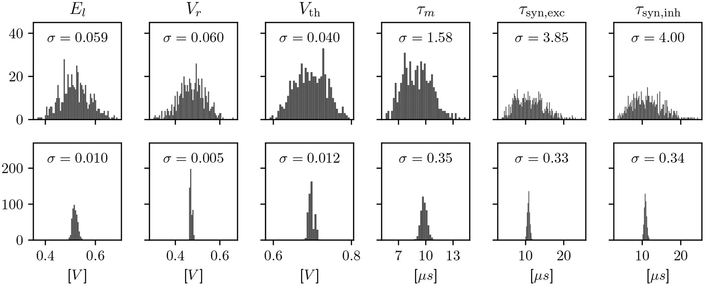

Pehle et al. · *Frontiers in Neuroscience published* · 2022  
[The BrainScaleS-2 Accelerated Neuromorphic System With Hybrid Plasticity](https://pmc.ncbi.nlm.nih.gov/articles/PMC8907969/#F2) · [原始图片](https://www.frontiersin.org/files/Articles/795876/xml-images/fnins-16-795876-g0002.webp) · [CC BY 4.0](https://creativecommons.org/licenses/by/4.0/) · [许可出处](https://www.frontiersin.org/journals/neuroscience/articles/10.3389/fnins.2022.795876/full)

## Fig. 3 · Firing patterns of AdEx neuron circuits

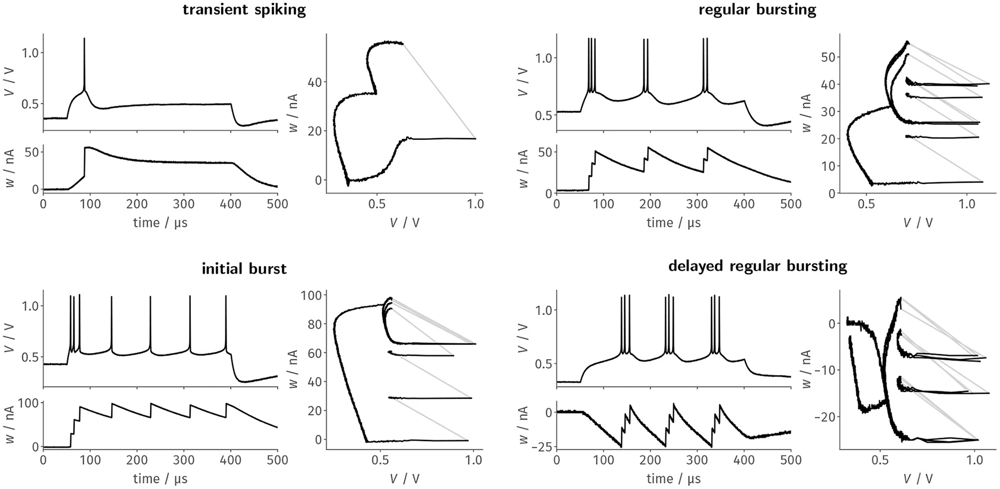

Pehle et al. · *Frontiers in Neuroscience published* · 2022  
[The BrainScaleS-2 Accelerated Neuromorphic System With Hybrid Plasticity](https://pmc.ncbi.nlm.nih.gov/articles/PMC8907969/#F3) · [原始图片](https://www.frontiersin.org/files/Articles/795876/xml-images/fnins-16-795876-g0003.webp) · [CC BY 4.0](https://creativecommons.org/licenses/by/4.0/) · [许可出处](https://www.frontiersin.org/journals/neuroscience/articles/10.3389/fnins.2022.795876/full)

